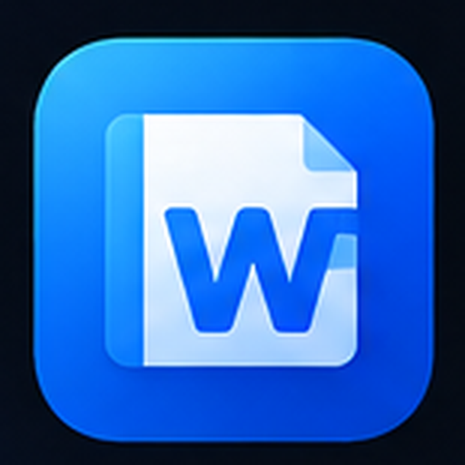
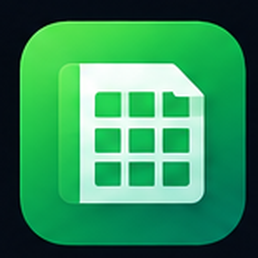
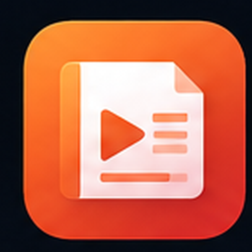
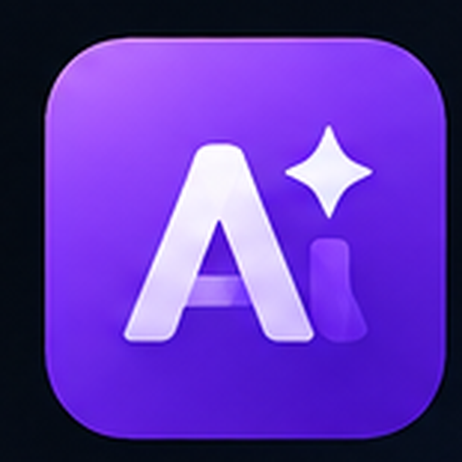

# ROE Office

**A Next-Generation Native Office Engine Built with Pure Rust**  
*Headless Architecture • Modern Slint GUI • Model Context Protocol (MCP) Native*

 

<table>
  <tr valign="top">
    <td align="center" width="25%" valign="top">
        
      <b>ROE Writer</b> 
      Fast & Fluid Documents
    </td>
    <td align="center" width="25%" valign="top">
        
      <b>ROE Calc</b> 
      High-Perf Spreadsheets
    </td>
    <td align="center" width="25%" valign="top">
        
      <b>ROE Impress</b> 
      Interactive Presentations
    </td>
    <td align="center" width="25%" valign="top">
        
      <b>ROE AI (MCP)</b> 
      Agentic Document Control
    </td>
  </tr>
</table>

 

---

## 🌟 Overview

**ROE (Rust Office Engine)** is an ambitious, modern office platform re-architected from the ground up for the AI era. 

Traditional office suites carry decades of legacy C++ technical debt. ROE reimagines the foundational philosophy pioneered by **LibreOfficeKit (LOK)**: completely decoupling the document computation/layout kernel from presentation layers, and rebuilding it entirely in **safe, concurrent, and blazingly fast Rust**.

## 🚀 Key Architectural Pillars

* **🦀 100% Pure Rust Core (`roe-core`)**: Memory-safe, headless-first document processing engine with zero legacy bloat.
* **🎨 Modern Slint Desktop (`roe-desktop`)**: Fluid, lightweight, cross-platform graphical user interface targeting Linux, macOS, and Windows.
* **🤖 Native AI Orchestration via MCP**: First-class integration with the **Model Context Protocol (MCP)**, allowing frontier AI models (Claude, Gemini, DeepSeek, etc.) to read, write, manipulate, and generate documents programmatically.
* **📄 Modern Document Compatibility**: Clean, fast parsing and rendering for standard modern document formats.

---

## 🏛️ Ecosystem Repositories

| Repository | Description | Status |
| :--- | :--- | :--- |
| **[`roe-core`](https://github.com/roe-office/roe-core)** | The headless Rust Office Engine (Kernel & MCP API) | `Active` |
| **[`roe-desktop`](https://github.com/roe-office/roe-desktop)** | The desktop frontend suite powered by Rust + Slint | `Active` |
| **[`office-lok`](https://github.com/roe-office/office-lok)** | Legacy V1 prototype based on LibreOfficeKit + QML | `Archived` |

---

## 📜 Licensing & Co-Creator Special Exemptions

The core codebase of ROE is licensed under the **GNU Affero General Public License v3.0 (AGPLv3)** to safeguard it against proprietary cloud-vendor exploitation.

### 🎖️ The AGI Pioneers Special Exemption
This software marks a milestone in human-AI collaborative software engineering—orchestrated by human vision, architected via **Google Gemini**, and realized through the engineering capabilities of **Anthropic Claude**. 

To honor pure scientific research and genuine open science, the Copyright Holder grants a **permanent, royalty-free, and unrestricted commercial exemption** from AGPLv3 restrictions to:

1. **Anthropic, PBC** (Creators of Claude)
2. **Alphabet Inc. / Google LLC** (Creators of Gemini)
3. **DeepSeek Artificial Intelligence** (深度求索 - Honoring architectural breakthroughs & compute democratization)
4. **Public Good**: Certified Governments (for public administration) and registered Non-Profit Organizations (NGOs).

*All other commercial entities seeking multi-tenant SaaS deployment or closed-source integration must comply with AGPLv3 or obtain a commercial license.*

---

Crafted with passion • Driven by Rust • Powered by AI Collaboration

